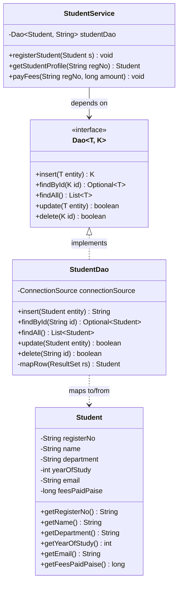

# Task A3: Data-Access Object (DAO) Design Pattern Architecture

**Course:** CSA09 – Programming in Java  
**Student Name:** R. Ranjith Kumar  
**Register Number:** 1924L260003  
**Institution:** Saveetha School of Engineering, SIMATS  

---

## 1. Analysis of Repeated JDBC Operations Across Domain Classes

In academic enterprise applications, persistence classes such as `StudentDB`, `CourseDB`, and `MarksDB` execute CRUD (Create, Read, Update, Delete) operations over relational tables. When implemented naively without architectural abstractions, each class replicates the identical 7-stage JDBC interaction pipeline:

```
+-----------------------------------------------------------------------------------+
| 1. Acquire Connection (DriverManager / HikariCP Pool)                              |
+-----------------------------------------------------------------------------------+
                                         |
                                         v
+-----------------------------------------------------------------------------------+
| 2. Allocate & Compile PreparedStatement (SQL Text with '?' Placeholders)          |
+-----------------------------------------------------------------------------------+
                                         |
                                         v
+-----------------------------------------------------------------------------------+
| 3. Parameter Binding (ps.setString(), ps.setInt(), ps.setLong())                 |
+-----------------------------------------------------------------------------------+
                                         |
                                         v
+-----------------------------------------------------------------------------------+
| 4. Execute Query/Update (ps.executeQuery() / ps.executeUpdate())                 |
+-----------------------------------------------------------------------------------+
                                         |
                                         v
+-----------------------------------------------------------------------------------+
| 5. Process ResultSet (Navigate cursor, extract columns, construct entity)         |
+-----------------------------------------------------------------------------------+
                                         |
                                         v
+-----------------------------------------------------------------------------------+
| 6. Deterministic Resource Cleanup (Close ResultSet, Statement, Connection)        |
+-----------------------------------------------------------------------------------+
                                         |
                                         v
+-----------------------------------------------------------------------------------+
| 7. Exception Translation (Trap SQLException, translate to Domain Exception)       |
+-----------------------------------------------------------------------------------+
```

### Breakdown of Invariant vs. Variant Elements

| Lifecycle Step | Invariant Across All DAOs? | What Specifically Varies? |
| :--- | :---: | :--- |
| **1. Connection Acquisition** | **Identical** | Nothing. All classes connect to the same JDBC URL/pool. |
| **2. Statement Preparation** | Structural Pattern Same | The exact SQL statement string (`INSERT INTO student...` vs `INSERT INTO course...`). |
| **3. Parameter Binding** | Structural Pattern Same | Number of parameters, column data types, and mapping of entity getters to parameter indices. |
| **4. Statement Execution** | **Identical** | Only whether `executeQuery()` (DQL) or `executeUpdate()` (DML) is invoked. |
| **5. ResultSet Row Mapping** | Structural Pattern Same | Which columns map to which domain constructor arguments or field setters. |
| **6. Resource Management** | **Identical** | Nothing. Closing resources safely via try-with-resources is identical. |
| **7. Exception Handling** | **Identical** | Nothing. Wrapping `SQLException` and logging error codes follows identical policy. |

**Key Insight:** Five of the seven steps are completely boilerplate. Only the SQL string, parameter binding, and entity mapping vary. The Data Access Object (DAO) pattern encapsulates this variance.

---

## 2. Generic `Dao<T, K>` Interface Design

To enforce standard CRUD contracts across all entities while maintaining compile-time type safety, we define a parameterized interface where:
- `T`: The domain model entity type (e.g., `Student`, `Course`, `Mark`).
- `K`: The primary key identifier type (e.g., `String`, `Long`, `Integer`).

```java
package com.simats.csa09.dao;

import java.util.List;
import java.util.Optional;

/**
 * Generic Data Access Object contract for persistent entities.
 * @param <T> Domain entity type
 * @param <K> Primary key identifier type
 */
public interface Dao<T, K> {

    /**
     * Persists a new entity into the underlying data store.
     * @param entity The entity instance to insert
     * @return The primary key of the inserted entity
     */
    K insert(T entity);

    /**
     * Retrieves an entity by its primary key identifier.
     * @param id The unique primary key
     * @return Optional containing the entity if found, or empty Optional
     */
    Optional<T> findById(K id);

    /**
     * Retrieves all persistent entity records.
     * @return List of all entities
     */
    List<T> findAll();

    /**
     * Updates an existing entity record in the database.
     * @param entity The entity with updated field values
     * @return true if a row was updated, false otherwise
     */
    boolean update(T entity);

    /**
     * Deletes an entity record by its unique primary key.
     * @param id The unique primary key to delete
     * @return true if a row was removed, false otherwise
     */
    boolean delete(K id);
}
```

---

## 3. Concrete Implementation: `StudentDao`

`StudentDao` implements `Dao<Student, String>`, specializing `T` to the `Student` domain class and `K` to `String` (representing the registration number).

### Algorithmic Pseudocode: `StudentDao.findById` (SIMATS Standard)

```text
ALGORITHM StudentDaoFindById
INPUT registerNo, dbConnectionSource
OUTPUT matchingStudentInstance OR NULL
BEGIN
    1. VALIDATE registerNo IS NOT NULL AND IS NOT EMPTY
    2. IF VALIDATION FAILS THEN
           RETURN NULL
       END IF

    3. sqlQuery <- "SELECT register_no, name, department, year_of_study, email, fees_paid_paise " +
                   "FROM student WHERE register_no = ?"

    4. TRY
           OPEN connection FROM dbConnectionSource
           PREPARE statement FROM sqlQuery
           SET parameter 1 OF statement TO registerNo
           resultSet <- EXECUTE_QUERY(statement)

           IF HAS_NEXT_ROW(resultSet) THEN
               regId   <- GET_STRING(resultSet, "register_no")
               sName   <- GET_STRING(resultSet, "name")
               dept    <- GET_STRING(resultSet, "department")
               year    <- GET_INTEGER(resultSet, "year_of_study")
               mail    <- GET_STRING(resultSet, "email")
               fees    <- GET_LONG(resultSet, "fees_paid_paise")

               studentObj <- CONSTRUCT Student(regId, sName, dept, year, mail, fees)
               RETURN studentObj
           ELSE
               RETURN NULL
           END IF

       ON ERROR sqlException
           LOG_ERROR "Database error querying student " + registerNo + ": " + sqlException.message
           RAISE DataAccessException("Persistence lookup failed", sqlException)
       FINALLY
           CLOSE resultSet
           CLOSE statement
           CLOSE connection
       END TRY
END
```

---

## 4. Object-to-Relational Mapping (ORM) Specification

### Domain Field to Relational Column Mapping Table
The `Student` entity in memory maps directly to the MySQL `student` relational table:

| Java Field Name | Java Data Type | Relational Column | SQL Data Type & Constraints | Architectural Design Rationale |
| :--- | :--- | :--- | :--- | :--- |
| `registerNo` | `String` | `register_no` | `VARCHAR(16) PRIMARY KEY` | University-issued student registration code (e.g., `1924L260003`). |
| `name` | `String` | `name` | `VARCHAR(80) NOT NULL` | Full student name. Variable length up to 80 characters. |
| `department` | `String` | `department` | `VARCHAR(40) NOT NULL` | Academic department code/name (e.g., `CSE`, `ECE`). |
| `yearOfStudy` | `int` | `year_of_study` | `TINYINT NOT NULL CHECK (year_of_study BETWEEN 1 AND 5)` | 1-byte storage footprint; valid range 1 to 5. |
| `email` | `String` | `email` | `VARCHAR(120) UNIQUE NOT NULL` | Official academic email address; unique index enforced. |
| `feesPaidPaise`| `long` | `fees_paid_paise`| `BIGINT NOT NULL DEFAULT 0 CHECK (fees_paid_paise >= 0)` | Stored as integer paise to prevent floating-point rounding drift. |

### Primary Key Selection Analysis
- **Selected Key**: `register_no` is chosen as a **Natural Primary Key**.
- **Justification**: The student register number is globally unique within the institution, immutable across the student's academic lifetime, assigned prior to database insertion, and physically printed on student ID cards, hall tickets, and fee receipts. Introducing an artificial surrogate key (such as an auto-incrementing `student_id BIGINT`) would introduce an unnecessary secondary index and duplicate uniqueness checks without adding domain value.

---

## 5. Architectural Class Diagram (UML)



---

## 6. Architectural Comparison: Generic DAO vs. Direct SQL in Service/GUI

| Evaluation Dimension | Dedicated Generic DAO Pattern | Direct SQL in GUI / Service Classes |
| :--- | :--- | :--- |
| **Separation of Concerns (SoC)** | **Strict**: Presentation handles user events; Service manages business rules; DAO handles SQL persistence. | **Violated**: GUI event listeners (`actionPerformed`) directly assemble SQL and manage JDBC sockets. |
| **SQL Injection Vulnerability** | **Centralized Audit**: All SQL strings reside in dedicated DAO classes utilizing parameterized queries. | **High Risk**: String concatenation (`"SELECT...'" + txtField.getText() + "'"` ) is easily scattered across many UI windows. |
| **Resource Leak Prevention** | **Guaranteed**: Connections, statements, and result sets are closed in centralized, bulletproof try-with-resources blocks. | **Severe Hazard**: GUI developers frequently forget `finally` or close calls, exhausting database connection pools. |
| **Schema Evolution Cost** | **Localized**: If column `email` is renamed, exactly one DAO file (`StudentDao.java`) is modified. | **Disastrous**: Every form, report, and button event handler across the codebase must be searched and modified. |
| **Unit Testability & Mocking** | **High**: Business logic in `StudentService` can be tested in isolation using a mock/in-memory `FakeStudentDao`. | **Impossible**: Testing GUI requires a live database server; unit testing business validation cannot be isolated. |
| **Code Reusability** | Methods like `findById()` or `findAll()` are written once and reused across REST APIs, CLI tools, and GUIs. | Redundant SQL strings copied and pasted across multiple UI dialogs and background threads. |
