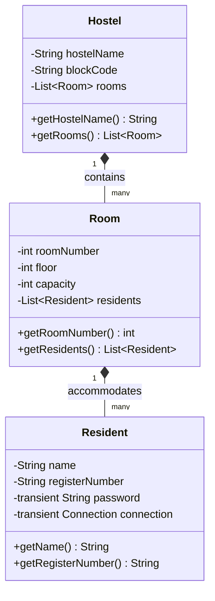

# Task A4: Object Serialization Architecture and Graph Persistence

**Course:** CSA09 – Programming in Java  
**Student Name:** R. Ranjith Kumar  
**Register Number:** 1924L260003  
**Institution:** Saveetha School of Engineering, SIMATS  

---

## 1. Domain Object Hierarchy and Scenario Modeling

Consider a campus accommodation management system modeled as a hierarchical object graph:
- A `Hostel` object contains a collection of `Room` objects.
- Each `Room` object contains a collection of `Resident` objects.
- A `Resident` represents a student staying in the room, containing:
  - `name` (`String`): Student's full name.
  - `registerNumber` (`String`): Unique academic student ID.
  - `password` (`String`): Student portal authentication credential.
  - `connection` (`java.sql.Connection`): Live active database socket connection.



---

## 2. Transient Field Identification and Deep Architectural Rationale

In Java, declaring a field with the `transient` keyword instructs `ObjectOutputStream` to bypass that field during serialization. In the `Resident` class, specific fields **must** be marked as `transient`:

| Field in `Resident` | Must be `transient`? | Technical & Security Architectural Rationale |
| :--- | :---: | :--- |
| `Connection connection` | **YES (Mandatory)** | **Non-Serializable System Resource**: A JDBC `Connection` is a runtime operating system socket tied to a specific TCP/IP port, file descriptor, server-side authentication session, and active database transaction state. It does not implement `java.io.Serializable`. If not marked `transient`, attempting to serialize `Resident` will immediately throw `java.io.NotSerializableException: com.mysql.cj.jdbc.ConnectionImpl`. Furthermore, even if serialized bytes were fabricated, upon deserialization in another JVM or machine, that remote physical TCP socket no longer exists. A restored object must always re-acquire connections from a managed connection pool. |
| `String password` | **YES (Mandatory)** | **Information Security & Confidentiality**: Java serialization outputs raw field values in plain binary representation. Passwords stored in serialized files are trivial to extract using basic string inspection (`strings hostel.ser`) or hex dump utilities. Writing plaintext credentials to non-volatile disk breaches OWASP credential storage standards. Deserialized objects must authenticate afresh via secure authentication tokens. |
| `String name` | **NO** | Core persistent domain state identifying the resident. |
| `String registerNumber`| **NO** | Core persistent natural key of the resident. |

**General Rule for Transient State:**
The `transient` modifier belongs to state that is **environmental, ephemeral, process-bound, or derived** (e.g., open file streams, thread references, GUI component peers, database sockets, cached temporary computations, and sensitive security secrets). Persistent identity and domain state should remain non-transient.

---

## 3. Object Graph Serialization Mechanics

When `objectOutputStream.writeObject(hostelInstance)` is invoked, Java executes a deep, recursive graph traversal:

```
+---------------------------------------------------------------------------------+
| Hostel Object (Root)                                                            |
|   |-- hostelName, blockCode                                                     |
|   +-- rooms List -------------------------------------------------------------+ |
+-------------------------------------------------------------------------------|-+
                                                                                |
         +----------------------------------------------------------------------+
         v
+---------------------------------------------------------------------------------+
| Room Object #1                                                                  |
|   |-- roomNumber = 101, floor = 1                                               |
|   +-- residents List ---------------------------------------------------------+ |
+-------------------------------------------------------------------------------|-+
                                                                                |
         +----------------------------------------------------------------------+
         v
+---------------------------------------------------------------------------------+
| Resident Object                                                                 |
|   |-- name = "R. Ranjith Kumar"         (SERIALIZED)                            |
|   |-- registerNumber = "1924L260003"    (SERIALIZED)                            |
|   |-- password                          (SKIPPED - transient: restored as null) |
|   +-- connection                        (SKIPPED - transient: restored as null) |
+---------------------------------------------------------------------------------+
```

### Key Graph Persistence Rules:
1. **Recursive Depth-First Traversal**: The stream serializes the `Hostel` metadata, inspects the `rooms` list, serializes each `Room`, inspects its `residents` list, and serializes each `Resident`.
2. **Cycle Detection and Shared Reference Preservation**: The serialization engine maintains an internal lookup table (`HandleTable`). If two different rooms share a reference to the same resident (or if a child object holds a backward reference to its parent `Room`), the object is written only once. Subsequent occurrences are written as compact integer **handles** (back-references). This prevents infinite recursive loops during cyclic references and guarantees that upon deserialization, the shared identity (`residentA == residentB`) remains identical.
3. **The Transitive `Serializable` Contract**: Every single non-transient class in the entire reachable object closure must explicitly implement `java.io.Serializable`. If a single leaf class (e.g., an embedded utility class inside `Room`) fails to implement `Serializable`, the entire serialization process halts and rolls back with `NotSerializableException`.

---

## 4. Schema Evolution: Adding a `phoneNumber` Field

Suppose version 1 of `Resident` was deployed and serialized to disk files. Later, system requirements mandate adding a new field:
```java
private String phoneNumber;
```

What occurs during deserialization depends critically on how `serialVersionUID` was handled:

### Scenario A: No Explicit `serialVersionUID` Declared (Compiler-Generated)
If the developer did not declare an explicit `serialVersionUID`, the Java compiler automatically computes a 64-bit cryptographic hash based on class signatures, method names, fields, modifiers, and implemented interfaces.
- Adding `phoneNumber` alters the compiled class structure.
- The newly generated hash differs from the hash recorded in the existing binary stream.
- **Result**: Deserialization fails immediately with a fatal exception:
  ```text
  java.io.InvalidClassException: com.simats.csa09.Resident;
  local class incompatible: stream classdesc serialVersionUID = -4829104829104,
  local class serialVersionUID = 7192840192840
  ```
- All previously saved hostel and student archive files become instantly unreadable.

### Scenario B: Explicit `serialVersionUID` Declared (`1L`)
If the original class declared:
```java
private static final long serialVersionUID = 1L;
```
and retained `serialVersionUID = 1L` in the updated class:
- The JVM detects matching version identifiers.
- The stream parser reads available fields (`name`, `registerNumber`) and notes that `phoneNumber` is absent in the old byte stream.
- **Result**: Deserialization **succeeds** seamlessly. The new `phoneNumber` field is automatically initialized to its language default value (`null` for Object references, `0` for numeric primitives, `false` for booleans).
- **Engineering Responsibility**: Application logic reading deserialized objects must defensively check for `null` (`if (resident.getPhoneNumber() != null)`) to maintain forward and backward compatibility.

---

## 5. Role and Purpose of `serialVersionUID`

1. **Version Control of Bytecode**: Serves as a formal version stamp that guarantees binary schema compatibility between the serialization sender and deserialization receiver.
2. **Deterministic Independence from Compilers**: Compiler-generated IDs can vary across different compiler vendors (e.g., Eclipse ECJ vs. Oracle `javac`) or build optimizations. Explicit declaration guarantees cross-platform consistency.
3. **Intentional Incompatibility Signaling**: If a breaking architectural change is introduced (e.g., altering `registerNumber` from `String` to a composite object `RegistrationKey`), the developer explicitly increments `serialVersionUID = 2L`, intentionally signaling to the JVM to reject incompatible legacy streams rather than silently corrupting memory.

---

## 6. Architectural Evaluation: Java Serialization vs. CSV vs. JSON

| Architectural Criterion | Java Native Serialization | Delimited Text (CSV / Pipe) | JSON (Jackson / Gson) |
| :--- | :--- | :--- | :--- |
| **Complex Nested Hierarchies** | **Native**: Automatically serializes deep arbitrary graphs | **Poor**: Requires manual flattening or multi-table file joining | **Native**: Easily represents hierarchical trees (arrays and nested objects) |
| **Cyclic & Shared References** | **Native**: Tracks object handles; handles cycles without infinite loops | **Impossible**: Flat tabular format cannot express cycles | **Requires Custom IDs**: JSON standards cannot represent cycles natively without `@JsonIdentityInfo` |
| **Human Readability** | **Opaque Binary**: Unreadable without specialized Java tools | **High**: Plain text readable with standard CLI utilities (`grep`, `awk`) | **High**: Highly readable, structured, and self-documenting |
| **Cross-Language Interoperability** | **Zero**: Strictly locked to the Java Virtual Machine ecosystem | **Universal**: Supported natively across Python, C++, Go, R, etc. | **Universal**: De facto standard for modern microservices and web APIs |
| **Schema Evolution Flexibility** | Strict; requires exact `serialVersionUID` and field management | Rigid; column reordering breaks positional parsing | **Flexible**: Easily tolerates added, removed, or renamed fields |
| **Security Risk Profile** | **Severe Vulnerability**: Deserialization of untrusted data allows arbitrary code execution (gadget chains) | **Safe**: Pure string data; no code execution risk | **Safe**: Pure structured data; secure when using standard parsers |
| **Payload Storage Density** | Compact binary representation | Smallest footprint for flat data | Moderate; repetitive attribute key names add overhead |

### Engineering Decision
For saving complex nested university records (such as `Hostel` $\rightarrow$ `Room` $\rightarrow$ `Resident`), **JSON** or a **Relational Database (JDBC)** is strongly superior to Java native serialization for persistence across application lifecycles. Native serialization should be avoided for long-term storage due to JVM lock-in, schema fragility, and critical remote code execution vulnerabilities when reading external files.
